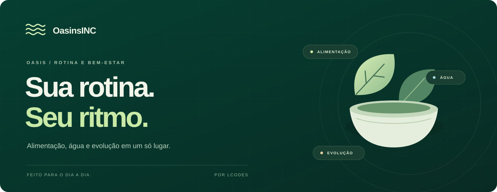

<p align="center">
  
</p>

<p align="center">
  <strong>Alimentação, calorias, hidratação e evolução em um espaço simples de usar.</strong><br>
  JavaScript + TypeScript · Node.js 24+ · SQLite / Cloudflare D1 · Português do Brasil
</p>

<p align="center">
  <a href="#comece-localmente">Rodar localmente</a> ·
  <a href="#o-que-já-funciona">Recursos</a> ·
  <a href="#como-o-projeto-se-organiza">Arquitetura</a> ·
  <a href="#estado-atual-e-limites">Limitações</a>
</p>

---

**OasinsINC é o repositório público da Oasis**, uma aplicação web de rotina e bem-estar criada por LCodes. O foco é registrar o que aconteceu no dia: refeições, porções, água, hábitos, treino e peso. A interface adapta-se ao celular e ao desktop, com temas claro, escuro e automático.

Esta edição começa sem contas nem registros pessoais. A identidade Oasis permanece na aplicação; OasinsINC é o nome deste repositório.

## O que já funciona

| Área | O que a aplicação oferece |
| --- | --- |
| **Alimentação** | Diário do dia, entrada manual e busca local em **582 alimentos TACO/NEPA-Unicamp**, com cálculo de calorias e macronutrientes por gramas. |
| **Hidratação e hábitos** | Registro rápido de água, meta ajustável e acompanhamento dos hábitos do dia. |
| **Peso** | Registro de medidas e histórico visual; meta informada pelo usuário. |
| **Treino** | Roteiro ilustrativo com marcação de exercícios, tempo de sessão e conclusão. Planos pessoais, quando fornecidos, ficam separados dos exemplos. |
| **Modo visitante** | Sem cadastro. Registros vazios na primeira entrada, armazenamento no navegador e validade de 24 horas. |
| **Contas** | Better Auth, confirmação de e-mail, recuperação de senha, Google OAuth e TOTP opcional, conforme os serviços configurados. |
| **Lembretes** | Horário, dias e fuso; Web Push por dispositivo, quando habilitado. |
| **Experiência** | Navegação Hoje / Comida / Treino / Peso / Mais, temas e instalação como aplicação web. |

O catálogo de alimentos é consultado no navegador. A busca não envia termos a um serviço externo. A [documentação dos dados](data/README.md) explica a origem, os arredondamentos e os registros excluídos.

## Comece localmente

Você precisa de **Node.js 24 ou superior**, npm e uma versão atual de Chrome, Edge, Firefox ou Safari. Node 24 é necessário para a implementação SQLite usada nos testes e no servidor Node. A conexão é necessária para instalar dependências; fontes da interface também são carregadas pelo Google Fonts.

Na pasta do projeto:

```sh
npm ci
npm run setup:local
npm run types
npm run db:local
npm run build
npm run dev
```

Abra **[http://localhost:4173](http://localhost:4173)** e escolha **Entrar como visitante**.

`setup:local` gera segredos novos em `.dev.vars`, não imprime os valores e preserva o arquivo caso ele já exista. A configuração pública do Wrangler usa D1 local e um identificador fictício; **não exige acesso à conta Cloudflare do autor**.

O modo visitante funciona sem e-mail, Google, Turnstile ou Web Push. Esses serviços começam desabilitados. Cadastro, recuperação e notificações não são simulados como se estivessem operacionais: precisam dos respectivos provedores. Os testes de autenticação usam contas e chaves sintéticas, com entrega de mensagens simulada.

> Use o endereço `localhost:4173` indicado no setup: origem, cookies e validações de segurança devem concordar com `APP_ORIGIN`.

## Comandos do projeto

| Comando | Finalidade |
| --- | --- |
| `npm run setup:local` | Cria a configuração local com chaves geradas no seu computador. |
| `npm run dev` | Executa o Worker e os assets localmente na porta 4173. |
| `npm run build` | Empacota o cliente de contas, o Worker e o servidor Node. |
| `npm run typecheck` | Gera os tipos do ambiente e verifica TypeScript. |
| `npm test` | Executa a suíte de testes, incluindo D1 temporário e SQLite em memória. |
| `npm run db:local` | Aplica as migrações somente ao D1 local. |
| `npm run db:generate` | Gera migrações a partir do schema Drizzle. |
| `npm run start:vps` | Executa o bundle Node já compilado, com ambiente previamente configurado. |

Validação usual:

```sh
npm run build
npm run typecheck
npm test
```

Os testes cobrem autenticação e isolamento entre contas, MFA, revogação de sessões, proteção criptográfica, conflitos de gravação, alimentação, planos, modo visitante, temas, inicialização e agendamento de lembretes. Eles não acessam o banco de uma instalação real.

## Como o projeto se organiza

```text
client/       Conta, entrada, visitante, diário alimentar e planos
dist/         HTML, CSS, interface principal, ícones e service worker
shared/       Schemas de dados compartilhados com Zod
server/       API, autenticação, criptografia, e-mail e Web Push
db/           Schema Drizzle
drizzle/      Migrações SQLite / D1
data/         Catálogo alimentar e documentação da origem
tests/        Testes e fixtures sintéticos
scripts/      Build, configuração local e importação TACO
deploy/       Exemplos adaptáveis de serviço, proxy e backup
docs/         Documentação e identidade visual do repositório
```

A mesma API pode rodar em dois ambientes:

| Ambiente | Entrada | Persistência |
| --- | --- | --- |
| **Worker** | `server/index.ts` | Cloudflare D1; Wrangler fornece o ambiente local. |
| **Node** | `server/node.ts` | SQLite com a camada compatível com D1 de `server/sqlite.ts`. |

No navegador, o modo visitante guarda os registros localmente. Em uma conta, as requisições passam pela autenticação e validação da API antes de gravar dados vinculados ao usuário. Drizzle descreve o schema; as migrações definem as tabelas.

`dist/` também contém arquivos-fonte da interface. O build gera `dist/account.js`, `build/server/index.js` e `build/vps/server.mjs`; esses arquivos gerados não devem ser editados diretamente.

## Configuração

Use [.env.example](.env.example) como referência. Cada instalação precisa de suas próprias chaves e serviços:

| Variável | Uso |
| --- | --- |
| `APP_ORIGIN`, `APP_ENV` | Origem autorizada e modo do ambiente. |
| `BETTER_AUTH_SECRET` | Segredo de autenticação, com pelo menos 32 caracteres. |
| `DATA_ENCRYPTION_KEY` | Chave de 32 bytes codificada em Base64 para os registros protegidos. |
| `EMAIL_ENABLED`, `EMAIL_FROM` | Ativação e remetente de e-mail. |
| `SMTP_*` | Servidor SMTP da implementação Node. |
| `GOOGLE_CLIENT_ID`, `GOOGLE_CLIENT_SECRET` | Cliente OAuth próprio; callback em `APP_ORIGIN/api/auth/callback/google`. |
| `TURNSTILE_SITE_KEY`, `TURNSTILE_SECRET_KEY` | Verificação contra robôs da sua instalação. |
| `VAPID_PUBLIC_KEY`, `VAPID_PRIVATE_KEY`, `VAPID_SUBJECT` | Web Push. |
| `DATABASE_PATH`, `PORT` | Caminho do banco e porta do servidor Node. |

O servidor Node exige origem e caminho de banco explícitos, usa cookies de produção e escuta somente em loopback. Ele foi preparado para operar atrás de um proxy HTTPS. Crie a pasta do banco e configure os serviços antes de executar `start:vps`.

Os arquivos em `deploy/` são **exemplos**: domínio, certificados, usuário, caminhos, proxy confiável e backups devem corresponder à sua infraestrutura. As páginas de privacidade e termos também são modelos desta edição; configure o contato e as práticas da sua instalação antes de receber dados de outras pessoas.

O comando `deploy:cloudflare` possui uma verificação de configuração e exige adaptação intencional para uma conta e domínio próprios. Clonar ou executar o setup local não publica a aplicação.

## Dados e privacidade

- O visitante começa sem refeições ou medidas. Os dados expiram 24 horas após a primeira entrada; não são transferidos automaticamente para uma conta.
- Registros de rotina, planos, lembretes e dados de push recebem AES-GCM no servidor, vinculados ao proprietário. Isso **não é criptografia ponta a ponta**.
- Nome, e-mail e metadados necessários à autenticação continuam acessíveis ao servidor.
- Sessões usam cookies HttpOnly e SameSite; a aplicação valida origem, entradas e propriedade dos registros.
- Nenhum banco, backup, conta real, segredo de produção ou configuração interna acompanha esta edição.
- As notificações usam texto genérico, sem colocar peso ou refeições na tela bloqueada.

Não envie dados de saúde, senhas, tokens ou dumps de banco em issues. Ao compartilhar um problema, use exemplos fictícios.

## Estado atual e limites

- O diário alimentar guarda **o dia corrente**. Não há navegação completa por um histórico alimentar de dias anteriores.
- Metas e exercícios de exemplo não são prescrições individuais. A aplicação organiza registros e não realiza diagnóstico.
- Não há editor completo de treinos nem exclusão/exportação automática da conta pela interface.
- Planos pessoais aguardando avaliação não liberam as sessões ilustrativas de treino.
- A aplicação é instalável como web app, mas **não oferece funcionamento offline completo**.
- Push depende de permissão, conexão e suporte do dispositivo. O agendamento não é um alarme de precisão garantida.
- Confirmação por e-mail, recuperação, Google OAuth e notificações exigem configuração e validação dos respectivos provedores.
- A suíte automatizada ajuda a verificar o comportamento; não substitui uma auditoria independente.

## Autoria e permissões

Projeto de **LCodes**. O banner desta documentação foi criado para OasinsINC; a aplicação preserva a identidade Oasis.

O código está disponível para consulta, sem aplicação de licença livre ao código próprio. Veja [LICENSING.md](LICENSING.md). Os dados TACO, ícones Lucide e dependências mantêm suas permissões e atribuições em [THIRD_PARTY_NOTICES.md](THIRD_PARTY_NOTICES.md).
